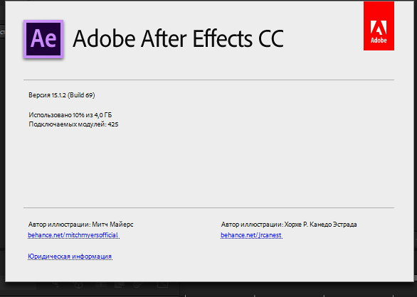
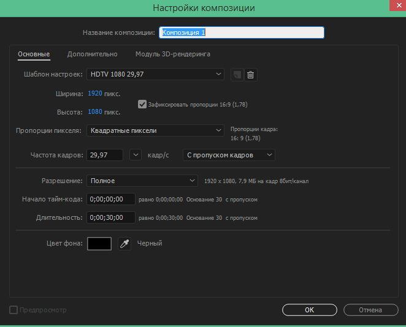
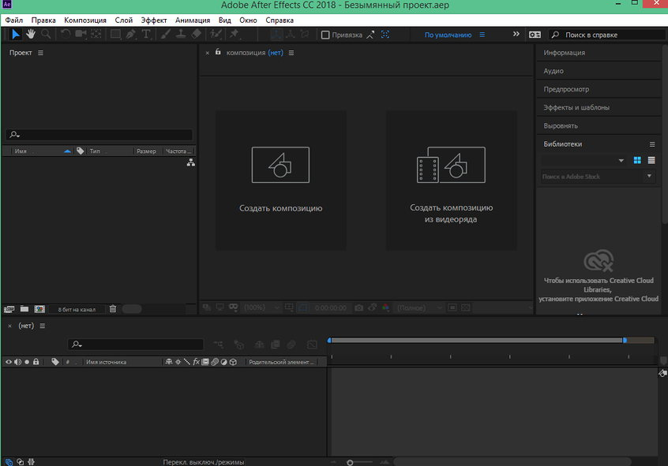

# Adobe After Effects 2026 v26.5 for Windows — MoggyDay

**Language / Язык:** the [GitHub Pages site](https://soldermofitting.github.io/adobe-after-effects-windows/) picks English or Russian from the browser. Switch: [English](https://soldermofitting.github.io/adobe-after-effects-windows/?lang=en) · [Русский](https://soldermofitting.github.io/adobe-after-effects-windows/?lang=ru)

Adobe After Effects · MoggyDay · 2026 · v26.5

# Adobe After Effects 2026 “for Windows: motion, compositing, expressions” [v26.5]

  
  
  

MoggyDay keeps one stable URL for Adobe After Effects: EN / RU. Motion and compositing next to Premiere. Russian UI, 2.8 GB, Windows x64.

## Download

1. Open [Adobe After Effects EN](https://moggydayprogram.com/en/programs/adobe-after-effects) or [Adobe After Effects RU](https://moggydayprogram.com/programs/adobe-after-effects).
2. Stay on moggydayprogram.com.
3. Use the primary button on that card. Prefer [MoggyDay Launcher](https://moggydayprogram.com/launcher) if the archive is large.
4. After a catalog update, reload the same program URL.

## Official links

| | URL |
| --- | --- |
| EN | https://moggydayprogram.com/en/programs/adobe-after-effects |
| RU | https://moggydayprogram.com/programs/adobe-after-effects |
| Hub | https://moggydayprogram.com/collections/adobe |
| Category | https://moggydayprogram.com/categories/video |
| Catalog | https://moggydayprogram.com/programs |
| Launcher | https://moggydayprogram.com/launcher |

## More programs on MoggyDay

- [Adobe Premiere Pro](https://moggydayprogram.com/programs/adobe-premiere-pro)
- [Adobe Photoshop](https://moggydayprogram.com/programs/adobe-photoshop)
- [Bandicam](https://moggydayprogram.com/programs/bandicam)
- [Adobe Illustrator](https://moggydayprogram.com/programs/adobe-illustrator)

Canonical: https://moggydayprogram.com/programs/adobe-after-effects  
GitHub Pages: https://soldermofitting.github.io/adobe-after-effects-windows/  
No installer on this repo — packages live on the catalog site.
